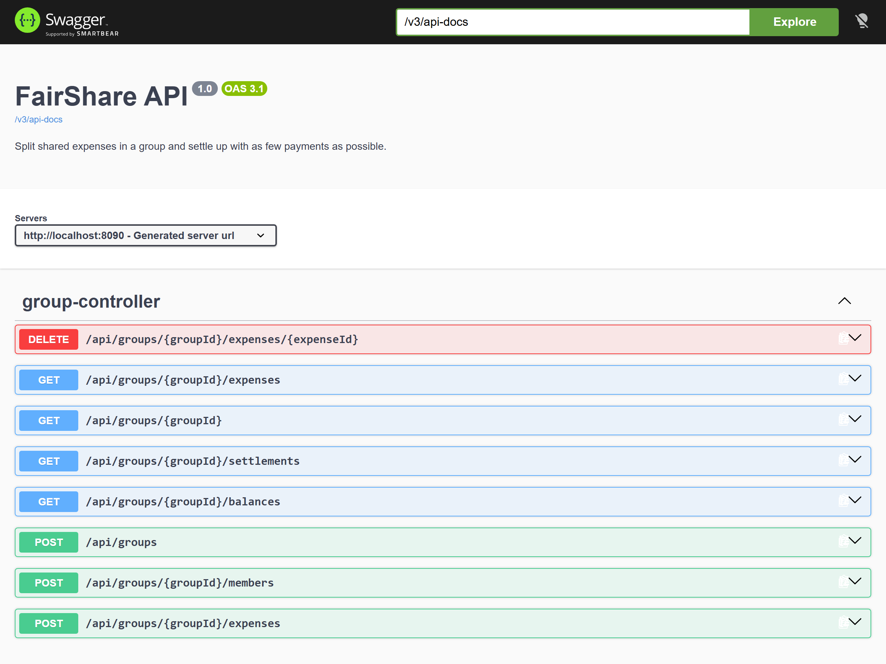

# FairShare API

[](https://github.com/ardapkr/fairshare-api/actions/workflows/ci.yml)


A REST API for splitting shared costs, like Splitwise: a group of flatmates or friends on a trip adds expenses,
and the API works out who owes what and **the fewest payments that settle everyone**.

Java · Spring Boot · Spring Data JPA · PostgreSQL / H2 · JUnit 5 · MockMvc · Docker · GitHub Actions



## Example

Three friends on a trip to Vienna:

```bash
curl -X POST localhost:8080/api/groups -H "Content-Type: application/json" \
  -d '{"name": "Vienna trip", "members": ["Arda", "Kate", "Mert"]}'

# Arda pays the train for everyone, Kate pays dinner for herself and Mert
curl -X POST localhost:8080/api/groups/1/expenses -H "Content-Type: application/json" \
  -d '{"description": "Train tickets", "amount": 89.70, "paidBy": 1}'
curl -X POST localhost:8080/api/groups/1/expenses -H "Content-Type: application/json" \
  -d '{"description": "Dinner", "amount": 64.20, "paidBy": 2, "participants": [2, 3]}'

curl localhost:8080/api/groups/1/settlements
```

```json
[
  {"fromMemberId": 3, "from": "Mert", "toMemberId": 1, "to": "Arda", "amount": 59.80},
  {"fromMemberId": 3, "from": "Mert", "toMemberId": 2, "to": "Kate", "amount": 2.20}
]
```

## Endpoints

| Method | Path | What it does |
|---|---|---|
| POST | `/api/groups` | Create a group with its members |
| GET | `/api/groups/{id}` | Group with members |
| POST | `/api/groups/{id}/members` | Add a member |
| POST | `/api/groups/{id}/expenses` | Add an expense (no `participants` = split between everyone) |
| GET | `/api/groups/{id}/expenses` | List expenses |
| DELETE | `/api/groups/{id}/expenses/{expenseId}` | Delete an expense |
| GET | `/api/groups/{id}/balances` | Net balance per member (+ is owed money, − owes money) |
| GET | `/api/groups/{id}/settlements` | Payments that settle all balances |

Interactive docs: <http://localhost:8080/swagger-ui.html>. Errors use the standard
[problem details](https://www.rfc-editor.org/rfc/rfc9457) format:

```json
{"status": 400, "title": "Bad Request", "detail": "Some fields are invalid",
 "errors": {"amount": "must be greater than 0"}}
```

## How it works

```
GroupController   HTTP → validated request records (Dtos.java)
      │
GroupService      use cases, transactions, checks that payer/participants belong to the group
      │                     │
repositories (JPA)     SettlementCalculator   pure Java, no Spring, easy to unit test
      │
PostgreSQL / H2
```

Design choices worth explaining:

- **Money is `long` cents, never `double`.** `0.1 + 0.2 != 0.3` in floating point. The API takes and returns
  decimals (`12.50`), [`Money`](src/main/java/dev/ardapeker/fairshare/settlement/Money.java) converts at the edge
  and rejects fractions of a cent instead of silently rounding.
- **Splitting adds up to the exact cent.** 10.00 between 3 people is 3.34 + 3.33 + 3.33. The leftover cents go
  to the members with the lowest ids, so the result is deterministic. The balances of a group always sum to 0.
- **Settling up is greedy.** The member who owes the most pays the member who is owed the most, until everyone
  is at 0. Every payment clears at least one person, so n members need at most n − 1 payments. The true
  minimum is NP-hard (it contains subset-sum), so a greedy rule is the usual practical choice.
- **The maths has no framework code.** [`SettlementCalculator`](src/main/java/dev/ardapeker/fairshare/settlement/SettlementCalculator.java)
  works on member ids and cents, so it is tested with plain JUnit, without starting Spring or a database.

## Run it

Needs Java 25 (the Maven wrapper downloads Maven).

```bash
./mvnw spring-boot:run          # in-memory H2 database, no setup
```

With PostgreSQL in Docker:

```bash
docker compose up --build       # API on :8080, data kept in a Docker volume
```

## Tests

```bash
./mvnw test
```

- `SettlementCalculatorTest`: equal splits, leftover cents, payer outside the split, chains of debts, and a
  randomised check (50 random groups) that the payments always settle everyone with at most n − 1 payments.
- `MoneyTest`: decimal ↔ cents conversion and rejection of fractions of a cent.
- `GroupApiTest`: the whole API through MockMvc against H2: create, add, delete, balances, settlements,
  validation errors, 404s, members from another group.

CI runs the tests, then builds the Docker image, starts it with PostgreSQL and makes real requests against it.

## Next steps

- Unequal splits (by percentage or exact amounts)
- Recording payments, so a settlement can be marked as paid
- Authentication, so groups are private to their members
- Flyway migrations instead of `ddl-auto=update`

**Tools:** Java 25 · Spring Boot · JPA · H2 · PostgreSQL · JUnit 5 · Docker · GitHub Actions · Claude Code

## License

MIT
